# Architecture

OXO est une application web **statique** : React 19 et TypeScript compilés par Vite. Il n’y a
aucun serveur applicatif, aucune base de données et aucun appel réseau au chargement. Le
contenu pédagogique est embarqué dans le bundle.

Diagramme interactif : [architecture.html](diagrams/architecture.html) · source :
[architecture.json](diagrams/src/architecture.json).

## Lecture du schéma

Le visiteur charge un bundle statique depuis Vercel. `main.tsx` monte `App` dans un
`ErrorBoundary`, qui affiche un écran de secours plutôt qu’une page blanche si un rendu
échoue.

`App` est la seule coquille : elle tient l’étape courante, le thème, le tiroir de navigation
et l’ouverture des dialogues, puis compose les quatre régions visibles — scènes d’étape,
panneau d’étape, tuteur flottant, dialogues glossaire et sources. Les données viennent de deux
modules purs :

- `src/content/lesson.ts` : textes, sources et métadonnées éditoriales ;
- `src/features/simulation/model/` : calcul du panier et hook d’état.

Le tuteur est local : ses réponses sont des règles déterministes dans
`src/features/tutor/model/tutorAnswer.ts`. Aucun modèle externe n’est appelé.

## Composants et responsabilités

| Zone | Rôle | Fichiers |
| --- | --- | --- |
| Entrée | Montage React, filet de sécurité | `src/main.tsx`, `src/app/ErrorBoundary.tsx` |
| Coquille | Étape, thème, navigation, dialogues | `src/app/App.tsx` |
| Routage d’étape | Lecture/écriture de `?etape=` | `src/app/route.ts` |
| Thème | `data-theme` + `localStorage` | `src/app/theme.ts`, `public/theme-init.js` |
| Contenu | Leçon typée | `src/content/lesson.ts` |
| Glossaire | Markdown compilé et validé | `src/content/concepts.ts`, `content/morocco/concepts/*.md` |
| Scène 1 | Panier personnel face à l’IPC | `src/features/prices/components/PriceStage.tsx` |
| Scène 2 | Simulation à hypothèses visibles | `src/features/simulation/components/BasketStage.tsx` |
| Modèle | Calcul pondéré et ventilation | `src/features/simulation/model/calculateBasket.ts` |
| Panneau | Narration, source, actions | `src/components/layout/StepPanel.tsx` |
| Tuteur | Règles locales, refus explicites | `src/features/tutor/` |
| Dialogues | Glossaire, sources, clavier | `src/components/layout/InfoDialog.tsx` |

## État de l’application

Pas de store global : l’état vit dans `App` et circule par props.

| État | Portée | Persistance |
| --- | --- | --- |
| Étape courante | `App` | query `?etape=manipuler` via `history.replaceState` |
| Thème clair/sombre | `App` + `<html data-theme>` | `localStorage["oxo-theme"]`, appliqué avant le premier rendu |
| Panier simulé | `useBasketSimulation` | mémoire seulement ; « Recommencer » réinitialise |
| Tiroir, tuteur, dialogues | `App` | éphémère |

L’URL est la source de vérité de l’étape : un lien `/?etape=manipuler` ouvre directement la
simulation, sans routeur ni rechargement. C’est ce qui rend une étape partageable sans ajouter
de dépendance.

## Pipeline de contenu

Diagramme interactif : [content-pipeline.html](diagrams/content-pipeline.html) · source :
[content-pipeline.json](diagrams/src/content-pipeline.json).

Les fiches du glossaire restent du Markdown lisible dans `content/morocco/concepts/`. Au build,
`import.meta.glob(..., { query: '?raw', eager: true })` les incorpore au bundle ; `parse()`
extrait le titre et les champs `**Définition simple**`, `**Source**` et `**Date de revue**`.
Un champ manquant lève une erreur : le build échoue, puis la CI. Aucune fiche incomplète ne peut
donc atteindre la production.

Les textes d’interface suivent la même règle : ils vivent dans `lesson.ts`, jamais recopiés
dans un composant. Modifier un texte, c’est modifier un seul fichier, revu et daté.

## Livraison

Diagramme interactif : [delivery-workflow.html](diagrams/delivery-workflow.html) · source :
[delivery-workflow.json](diagrams/src/delivery-workflow.json).

Deux chaînes tournent en parallèle sur un push :

1. **GitHub Actions** installe, vérifie les types, le lint et les tests, construit le bundle et
   conserve `dist` sept jours comme artefact de diagnostic.
2. **Vercel** reconstruit le bundle avec `vercel.json`, applique les en-têtes et publie sur son
   CDN.

Elles sont indépendantes : un push dont la CI échoue peut être déployé si la protection de
branche n’est pas active. Ce point est traité dans
[la mise en production](production.md#point-de-vigilance--ci-et-vercel-sont-indépendants).

## Décisions structurantes

- **Pas de routeur.** Deux étapes, un paramètre d’URL : ajouter React Router serait une
  dépendance sans bénéfice mesurable.
- **Tokens CSS sémantiques.** Les composants n’utilisent pas de couleurs en dur ; le thème
  sombre est une seconde valeur des mêmes tokens sur `:root[data-theme="dark"]`.
- **CSP stricte.** Script de thème dans un fichier séparé, styles servis par la feuille Vite,
  aucun `unsafe-inline`. Voir [production.md](production.md#en-têtes-et-csp).
- **Tuteur borné.** Mieux vaut un assistant qui avoue ne pas savoir qu’une réponse inventée.
  Le fournisseur réel reste une décision ouverte (`T020`).

## Limites connues

- **Pas de prérendu.** Le HTML initial ne contient pas le contenu de l’étape ; les robots
  d’aperçu social ne voient que les métadonnées génériques d’`index.html`.
- **Pas de piège de focus.** Les dialogues déplacent le focus et répondent à `Échap`, mais la
  tabulation peut sortir de la boîte. Correctif prévu : boucle de focus partagée.
- **Tuteur non génératif.** Les réponses couvrent un corpus fermé ; une question hors corpus
  reçoit une abstention explicite.
